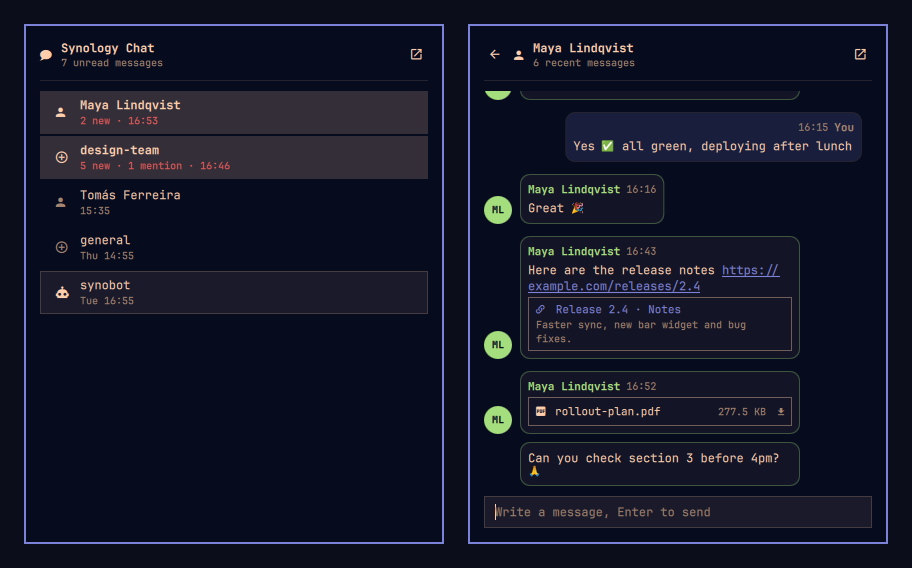

# Synology Chat for Omarchy

A bar widget for [Synology Chat](https://www.synology.com/dsm/feature/chat).
It shows an unread badge in the bar and opens a panel where you can read
channels and direct messages and reply to them. Desktop notifications tell you
when new messages arrive.

## Features

- **Unread badge:** the bar icon shows the number of unread messages and turns
  urgent when there are any.
- **Channels and DMs:** unread conversations are listed first. Opening one marks
  it as read on the server too.
- **Conversation view:**
  - your messages are on the right and everyone else's are on the left;
  - each person has their own color and profile picture;
  - consecutive messages from the same person are grouped.
- **Links:** links in messages are clickable, and the page title appears when
  the server has fetched it.
- **Images and files:** images show as previews. Clicking any attachment
  downloads it to `~/Downloads` and opens it.
- **Emoji:** Chat shortcodes (`:tada:`) and smileys (`:-)`) are shown as
  emoji.
- **Notifications:** you get a desktop notification with a preview of new
  messages. There is no notification for the conversation you are already
  looking at.
- **Keyboard:**
  - arrows and Enter open a channel;
  - Enter sends and Esc goes back;
  - PageUp/PageDown scroll;
  - `r` refreshes and `o` opens the desktop app.

## Requirements

- Omarchy with the Quattro shell
- A Synology NAS running Synology Chat Server, reachable from this machine
- `python3`, standard library only
- `secret-tool` (libsecret) and a running keyring, such as GNOME Keyring
- `notify-send` (libnotify) for notifications
- `xdg-open` (xdg-utils) for links and files
- Optional: the Synology Chat desktop app, which middle click opens

Two-factor authentication on the DSM account is not supported yet.

## Install

    omarchy plugin add https://github.com/Hiutaky/omarchy-synology-chat --enable

Then click the chat icon in the bar and choose **Set up Synology Chat**. A
terminal opens and asks for three things:

- the DSM address with its port, for example `https://nas.local:5001`;
- your DSM user;
- your password.

The address and user are saved to `~/.config/omarchy-synochat/config.json`.
The password goes to the system keyring and never into a file.

You can also run the setup by hand:

    ~/.config/omarchy/plugins/hiutaky.synology-chat/scripts/synochat setup

## Settings

These are plugin settings, all optional:

| Setting | Default | |
|---|---|---|
| Server | from setup | DSM address; it overrides the one from setup |
| DSM user | from setup | |
| Verify TLS certificate | Off | Off pins the certificate confirmed during setup (fine for self-signed DSM certificates). Turn this on if yours is from a trusted CA |
| Desktop notifications | On | |
| Refresh interval | 20 s | The panel refreshes every 5 s while it is open |

## Usage

- **Left click:** open the panel
- **Middle click:** open the Synology Chat desktop app
- **Right click:** refresh

The plugin also answers IPC calls:

    omarchy-shell hiutaky.synology-chat toggle
    omarchy-shell hiutaky.synology-chat openChannel <channel-id>
    omarchy-shell hiutaky.synology-chat unread
    omarchy-shell hiutaky.synology-chat refresh

## How it works

The panel talks to the DSM Web API (`SYNO.Chat.*`), the same API the Chat web
app uses, through `scripts/synochat`. That helper is a small Python script with
no dependencies beyond the standard library, and it prints JSON. It logs in
with its own DSM session, so it does not touch the desktop app's session.

The plugin stores data in these places:

- `$XDG_RUNTIME_DIR/omarchy-synochat-*`: the session ID, the user list and
  notification state;
- `~/.cache/omarchy-synochat/`: image previews and profile pictures;
- `~/.config/omarchy-synochat/config.json`: the server address and user.

For screenshots, setting the plugin setting `demo` to `On` serves made-up
conversations without any server:

    omarchy bar set hiutaky.synology-chat demo On

## Remove

    omarchy plugin remove hiutaky.synology-chat
    secret-tool clear service omarchy-synochat
    rm -rf ~/.config/omarchy-synochat ~/.cache/omarchy-synochat

## Privacy and security

Your password stays in the keyring. It is sent only to the DSM server you
configure, over HTTPS.

With **Verify TLS certificate** off, setup shows the SHA-256 fingerprint of
the certificate your NAS presents and asks you to trust it; from then on the
plugin only talks to a server with that exact certificate, so self-signed DSM
certificates work without accepting just any certificate. If the certificate
changes (for example after a renewal) the widget asks you to run setup again.
Turn the option on if your certificate comes from a trusted CA.

Messages you send and notification previews are passed through stdin and
D-Bus, never on a command line, and cached avatars and image previews are
readable only by you.

Like every Omarchy plugin, this one runs unsandboxed with your user
permissions.

## Credits

Emoji shortcodes follow the [EmojiOne](https://github.com/joypixels/emojione)
short names that Synology Chat uses.

## Disclaimer

This is an unofficial, community plugin and is not affiliated with or endorsed by
Synology Inc. Synology and Synology Chat are trademarks of Synology Inc.

## License

MIT, see [LICENSE](LICENSE).
